# Beauty Scan

وثيقة المشروع الرئيسية. تصف ما هو موجود في الملفات والكود وقاعدة البيانات المحلية التي فُحصت، وتفصل بين ما هو مكتوب في الكود وما هو حالة البيانات الحالية فقط.

لا يوجد ملف إصدار، ولا سجل تغييرات، ولا رقم إصدار في المشروع. لا توجد شركات متعددة ولا أقسام تنظيمية.

## فهرس المحتويات

1. [ما هو المشروع؟](#1-ما-هو-المشروع)
2. [لماذا يوجد؟](#2-لماذا-يوجد-هذا-المشروع)
3. [من يستخدمه؟](#3-من-يستخدمه)
4. [ماذا يستطيع النظام أن يفعل؟](#4-ماذا-يستطيع-النظام-أن-يفعل)
5. [كيف يعمل النظام؟](#5-كيف-يعمل-النظام)
6. [أمثلة واقعية](#6-أمثلة-واقعية)
7. [رحلة المستخدم](#7-رحلة-المستخدم)
8. [الوحدات والأقسام](#8-الوحدات-والأقسام)
9. [الشركات والكيانات](#9-الشركات-والكيانات)
10. [الصلاحيات](#10-الصلاحيات)
11. [الأتمتة](#11-الأتمتة-وworkflows)
12. [التكامل بين الوحدات](#12-التكامل-بين-الوحدات)
13. [المصطلحات](#13-المصطلحات)
14. [الأسئلة الشائعة](#14-الأسئلة-الشائعة)
15. [Architecture](#15-architecture)
16. [Tech Stack](#16-tech-stack)
17. [Project Structure](#17-project-structure)
18. [Frontend](#18-frontend)
19. [Backend](#19-backend)
20. [Request Flow](#20-request-flow)
21. [Database](#21-database)
22. [API](#22-api)
23. [Authentication](#23-authentication--authorization)
24. [Security](#24-security)
25. [Configuration](#25-configuration)
26. [Integrations](#26-integrations)
27. [Scheduled Jobs](#27-scheduled-jobs)
28. [File Storage](#28-file-storage)
29. [Logging](#29-logging--monitoring)
30. [Installation](#30-installation)
31. [Development Guide](#31-development-guide)
32. [Deployment](#32-deployment)
33. [Backup](#33-backup--recovery)
34. [Troubleshooting](#34-troubleshooting)
35. [Dependencies](#35-dependencies)
36. [Known Limitations](#36-known-limitations)
37. [Current System State](#37-current-system-state)
38. [Architecture Decisions](#38-architecture-decisions)
39. [Changelog](#39-changelog)
40. [System Overview](#system-overview)
41. [Quick Reference](#quick-reference)
42. [Quick Start](#quick-start)
43. [لغير المتخصص](#for-non-technical-users)
44. [للمطور](#for-developers)

## 1. ما هو المشروع؟

Beauty Scan موقع ويب لمراجعة منتجات المكياج والعناية بالبشرة. المستخدم يسجّل حساباً، يسجّل المواد التي يتحسس منها، ثم يبحث عن منتج برقم الباركود أو يضيفه إلى خزانته مع تاريخ الصلاحية وتاريخ الفتح.

الموقع يعرض:

- هل رقم المراقبة في الباركود صحيح.
- هل بيانات الاسم والعلامة وقائمة المكونات مكتملة، وهل السجل موثّق.
- شرح المكونات الموجودة في جدول `ingredients`.
- المواد التي تطابق ما سجّله المستخدم.
- تاريخ الانتهاء الفعلي، والتنبيه قبل هذا التاريخ.

الحكم في الكود مطابقة بيانات، وليس فحصاً مختبرياً للعبوة. النص الظاهر للمستخدم يذكر أن المعلومة إرشادية. لا يوجد نموذج ذكاء اصطناعي في المشروع.


هذه رئيسية الزائر من `index.php`. الزرّان تسجيل حساب ودخول. لا تظهر أقسام الحساب قبل الجلسة.

## 2. لماذا يوجد هذا المشروع؟

الصفحات والكود يحلان ثلاث حاجات ظاهرة:

- التمييز بين منتج بياناته مكتملة وموثقة، ومنتج ناقص أو رقمه غير صحيح.
- مقارنة قائمة المكونات بمواد الحساسية التي كتبها المستخدم. إذا كانت القائمة فارغة، النتيجة «تعذر فحص الحساسية» وليست «لا توجد حساسية».
- متابعة صلاحية ما يملكه المستخدم: التاريخ المطبوع، ومدة الاستخدام بعد الفتح (PAO)، والتنبيه داخل الحساب.

لا توجد وثيقة متطلبات مستقلة خارج هذا الملف والكود. أي هدف غير ظاهر في الصفحات أو الدوال غير موثق.

## 3. من يستخدمه؟

الأدوار الموجودة في الكود أربعة، وليست شركات أو وظائف وظيفية:

| الدور | كيف يُعرف | ماذا يرى |
| --- | --- | --- |
| زائر | لا توجد جلسة | الرئيسية `index.php`، الدخول، تسجيل الحساب |
| مستخدم لم يكمل الإعداد | `users.onboarding_done = 0` | يُحوَّل إلى `onboarding.php`. القائمة لا تعرض الأقسام |
| مستخدم جاهز | `onboarding_done = 1` | لوحة التحكم، المسح، المنتجات، الحساسية، التنبيهات، الحساب |
| مسؤول | `users.is_admin = 1` ويشترط اكتمال الإعداد | ما يراه المستخدم الجاهز، بالإضافة إلى `admin.php` |

لا يوجد دور «موظف» ولا «مدير شركة» ولا صلاحيات جزئية داخل الأقسام. المسؤول يرى كل الحسابات وكل المنتجات في لوحة الإدارة، ويغيّر `is_verified` فقط.

## 4. ماذا يستطيع النظام أن يفعل؟

- تسجيل حساب باسم مستخدم وكلمة سر واسم معروض، والبريد اختياري.
- تسجيل الدخول والخروج باسم المستخدم فقط. لا يوجد دخول بالبريد أو الجوال.
- إعداد الحساسية مرة أولى مع إمكانية التخطي، ثم الإضافة والحذف لاحقاً.
- مسح الباركود بالكاميرا إن دعم المتصفح `BarcodeDetector` و`getUserMedia`، أو كتابة الرقم يدوياً.
- عرض منتج: الحكم، الأسباب، شرح المكونات، نتيجة الحساسية، والصورة إن وُجد ملف jpg مطابق للرقم.
- البحث في الجدول المحلي `products` ثم، إن غاب المنتج ورقم المراقبة صحيح، طلب Open Beauty Facts وحفظ النتيجة.
- إضافة منتج إلى حساب المستخدم وتعديله وحذفه، مع تاريخ صلاحية إلزامي وتاريخ فتح وPAO اختياريين.
- حساب التاريخ الفعلي والحالة: صالح، قريب الانتهاء، خلال 7 أيام، منتهي.
- إنشاء تنبيهات داخل الحساب، وإرسال بريد فقط إذا اكتملت إعدادات SMTP وكان للمستخدم بريد.
- تعديل الاسم المعروض والبريد وأيام التنبيه (من 1 إلى 180)، وتغيير كلمة السر.
- لوحة إدارة: عدد الحسابات والمنتجات والتنبيهات، وتوثيق منتج أو إلغاء توثيقه.

غير موجود في الكود: سلة شراء، دفع، طلبات، عقود، أخبار، موظفين، رفع صور من المستخدم، رسائل SMS، تحليلات، دردشة.

## 5. كيف يعمل النظام؟

1. المتصفح يطلب صفحة PHP.
2. `includes/bootstrap.php` يقرأ `.env`، يضبط سجل الأخطاء في `data/app.log`، ويفتح MySQL.
3. `init_db()` ينشئ الجداول إن غابت، ويضيف عمود `is_admin` إن غاب، ثم يعبئ المكونات والمنتجات التجريبية إن كانت الجداول فارغة، وينشئ حسابات التجربة إن وُجدت قيمها في `.env`.
4. `load_session()` يقرأ كعكة `bs_session`. القيمة المخزنة في `sessions.id` هي SHA-256 للرمز، وليست الرمز نفسه.
5. الصفحة تُرسم في PHP. العمليات التي تغيّر البيانات يرسلها `assets/js/app.js` إلى `api.php?action=...` كـ JSON مع ترويسة `X-CSRF-Token`.
6. بعد الحفظ تعيد الواجهة رسالة أو مسار تحويل، والمتصفح ينتقل أو يحدّث الصفحة.

كل صفحة ملف PHP مستقل. لا يوجد إطار ولا تطبيق صفحة واحدة.

## 6. أمثلة واقعية

الأمثلة التالية مبنية على الدوال والبيانات التجريبية في `includes/seed.php`. كلمات سر الحسابات غير مكتوبة هنا. إن وُجدت فهي في `TEST_ACCOUNTS.txt` على الجهاز المحلي فقط، والملف ممنوع من المتصفح ومن Git.

### تسجيل حساب

1. الزائر يفتح `register.php` ويرسل `api.php?action=register`.
2. `register_user()` يشترط اسماً من 3 إلى 30 حرفاً لاتينياً أو رقماً أو `.` أو `_`، وليس أرقاماً فقط، واسماً معروضاً من 2 إلى 60 حرفاً، وكلمة سر من 8 أحرف تتطابق مع التأكيد.
3. يُدرج صف في `users` مع `onboarding_done = 0` و`notice_days = 30` و`password_hash` من `password_hash(..., PASSWORD_BCRYPT)`.
4. تُفتح جلسة في `sessions` ويُحوَّل إلى `onboarding.php`.

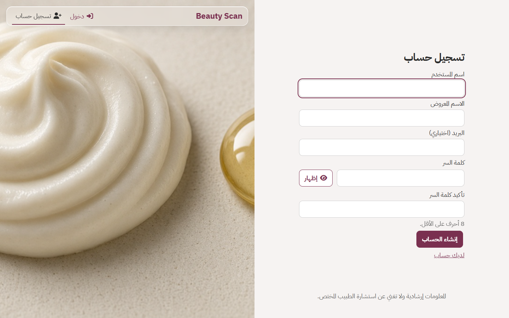

نموذج `register.php`: اسم المستخدم، الاسم المعروض، البريد الاختياري، وكلمة السر مع التأكيد.

### إعداد الحساسية

1. المستخدم يكتب مواداً أو يختارها. الطلب `allergens_save`. الحد في الواجهة 40 اسماً في الطلب الواحد.
2. `add_allergens()` يدرج في `user_allergens`. القيد `uniq_user_allergen` يمنع تكرار الاسم الموحّد لنفس المستخدم.
3. إن أُرسل `finish=1`، أو طُلب `onboarding_skip`، تصبح `onboarding_done = 1` ويُحوَّل إلى `dashboard.php`.

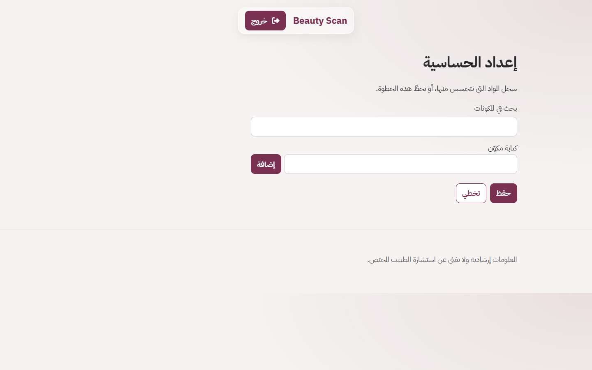

`onboarding.php` للحساب الذي لم يُكمل الإعداد. القائمة لا تعرض الأقسام بعد.

### مسح منتج تجريبي موثّق

الباركود `6281000000014` في التعبئة الأولى هو «منتج تجريبي غسول يومي»، علامته «علامة تجريبية»، ومكوناته تتضمن Parfum وLimonene، و`is_verified = 1`.

1. المستخدم الجاهز يفتح `scan.php` ويرسل `lookup`.
2. `ensure_product()` يجد الصف في `products` ولا يطلب المصدر الخارجي.
3. `judge_product()` يعيد `trusted` لأن الرقم صحيح والحقول مكتملة والسجل موثّق.
4. `match_allergens()` يقارن النص بمواد المستخدم. حساب التجربة المعبأ يُنشأ وفي حساسيته Parfum وLimonene، فيظهر تطابق لهذين الاسمين إن بقيت تلك الصفوف.
5. الصفحة `product.php?barcode=6281000000014`. الصورة تُعرض إن وُجد `assets/images/products/6281000000014.jpg`.

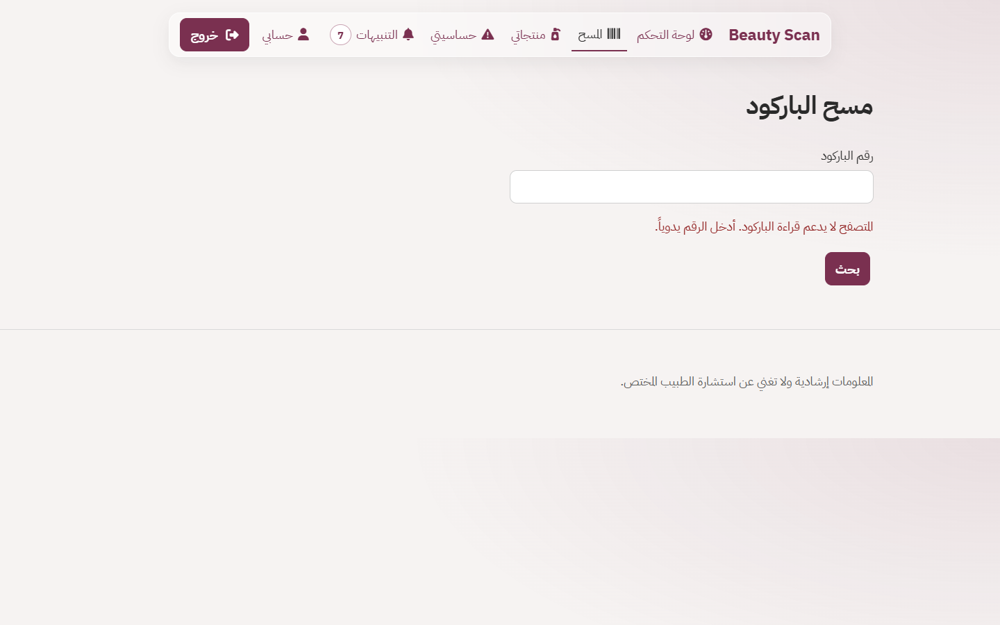
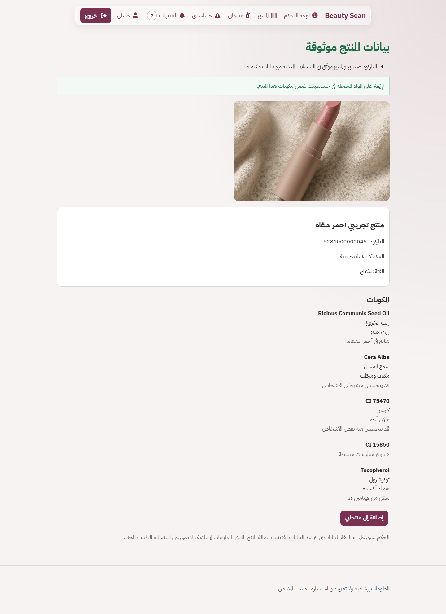

`scan.php` يبقي الرقم اليدوي إن لم تعمل الكاميرا. `product.php` تعرض الصورة والحكم ونتيجة الحساسية إن وُجدت قائمة مكونات. اللقطة الثانية لباركود من الخزانة التجريبية.

### منتج ناقص أو غير موثّق

من `product_rows()` و`demo_barcodes()`:

| الباركود | الاسم في التعبئة | ماذا ينقص |
| --- | --- | --- |
| `6281000000113` | منتج تجريبي ناقص المكونات | قائمة المكونات فارغة، `is_verified = 0` |
| `6281000000120` | منتج تجريبي بلا علامة | العلامة فارغة والمكونات فارغة |
| `6281000000137` | منتج تجريبي غير موثّق | الاسم والعلامة والمكونات مكتملة، لكن `is_verified = 0` وليس المصدر Open Beauty Facts، فالحكم يحتاج إلى تحقق |
| `6281000000144` | منتج تجريبي موثّق بلا مكونات | `is_verified = 1` لكن المكونات فارغة، فالحكم يحتاج إلى تحقق ولا تُفحص الحساسية |

صيغ أخرى في التعبئة: EAN-8 `96385074`، وUPC-A `123456789012`.

### إضافة منتج إلى الخزانة

1. من `product_form.php` يُرسل `product_save`.
2. `save_user_product()` يحفظ في `user_products`: الاسم أو الربط بالباركود، وتاريخ الصلاحية، وتاريخ الفتح، و`pao_months`، و`effective_expiry_date`.
3. التاريخ الفعلي من `effective_expiry()`: الأبكر بين التاريخ المطبوع وتاريخ الفتح مضافاً إليه أشهر PAO.
4. عند الدخول أو فحص التنبيهات، `scan_user()` يدرج صفاً في `notifications` إذا وصلت المرحلة. المفتاح `معرّف الصف:النوع` فريد، فلا يتكرر التنبيه نفسه.

حساب التجربة المعبأ، عند إنشائه أول مرة فقط، يضيف خمسة منتجات: غسول بعد 90 يوماً، سيروم بعد 20 يوماً، واقي شمس بعد 4 أيام، أحمر شفاه قبل 10 أيام، وكريم مرطب تاريخه المطبوع بعد 400 يوم لكنه مفتوح قبل 20 يوماً وPAO شهر واحد فيصبح التاريخ الفعلي من الفتح.

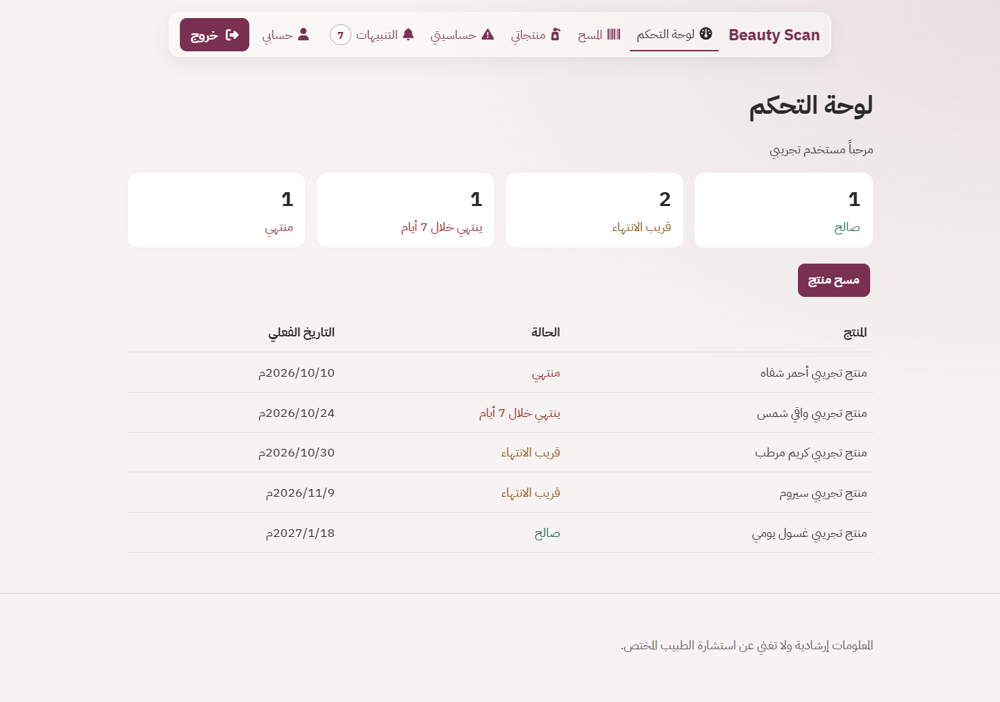
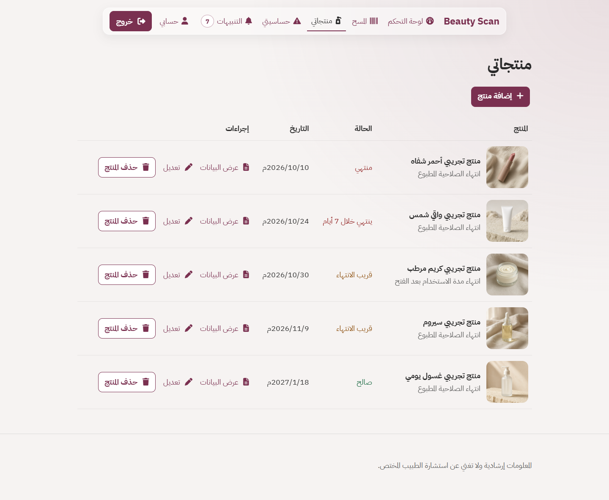

لوحة التحكم تلخّص الحالات. «منتجاتي» جدول الخزانة: الصورة والاسم والحالة والتاريخ الفعلي وإجراءات العرض والتعديل.

### توثيق من الإدارة

المسؤول يفتح `admin.php` ويضغط توثيق أو إلغاء التوثيق. الطلب `admin_verify` يحدّث `products.is_verified` فقط. لا يحذف المنتج ولا يعدل نص المكونات.

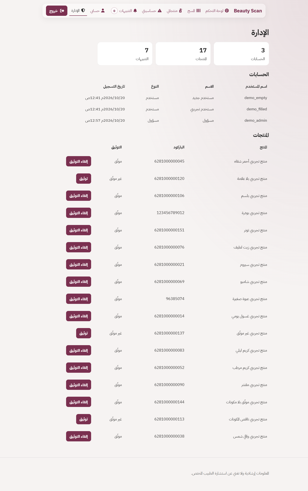
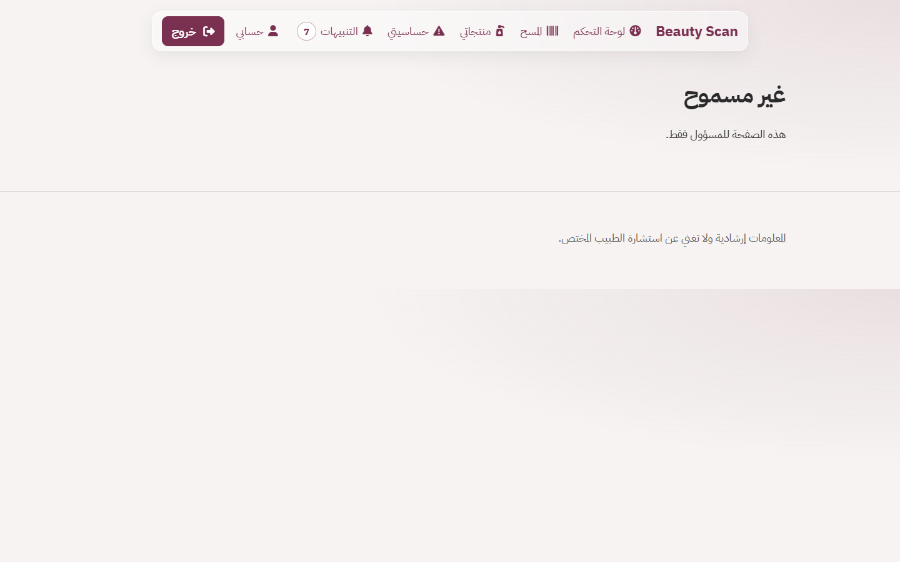

الأولى `admin.php` للمسؤول. الثانية صفحة 403 للمستخدم الجاهز غير المسؤول، ونصها «هذه الصفحة للمسؤول فقط».

### تغيير البريد

`update_profile()` يحدّث الاسم و`notice_days` دون كلمة السر. إذا تغيّر البريد عن القيمة المخزنة، يشترط `password_verify` لكلمة السر الحالية. لا يوجد رمز OTP ولا رابط تأكيد في الكود.

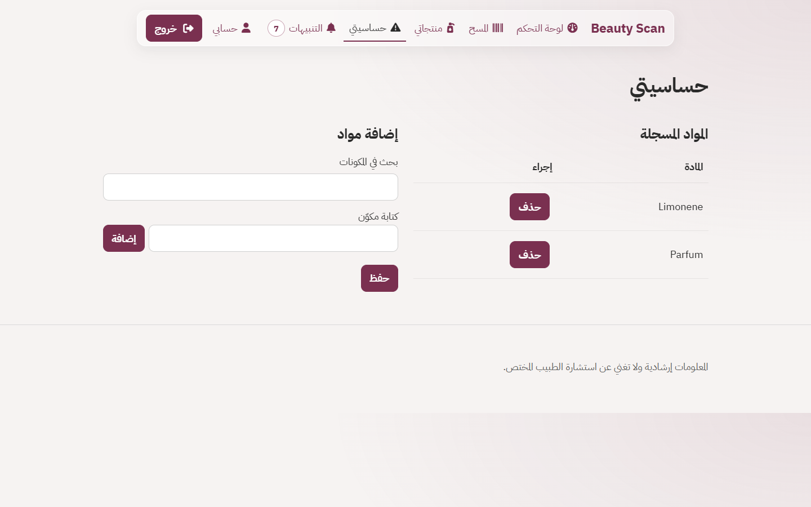
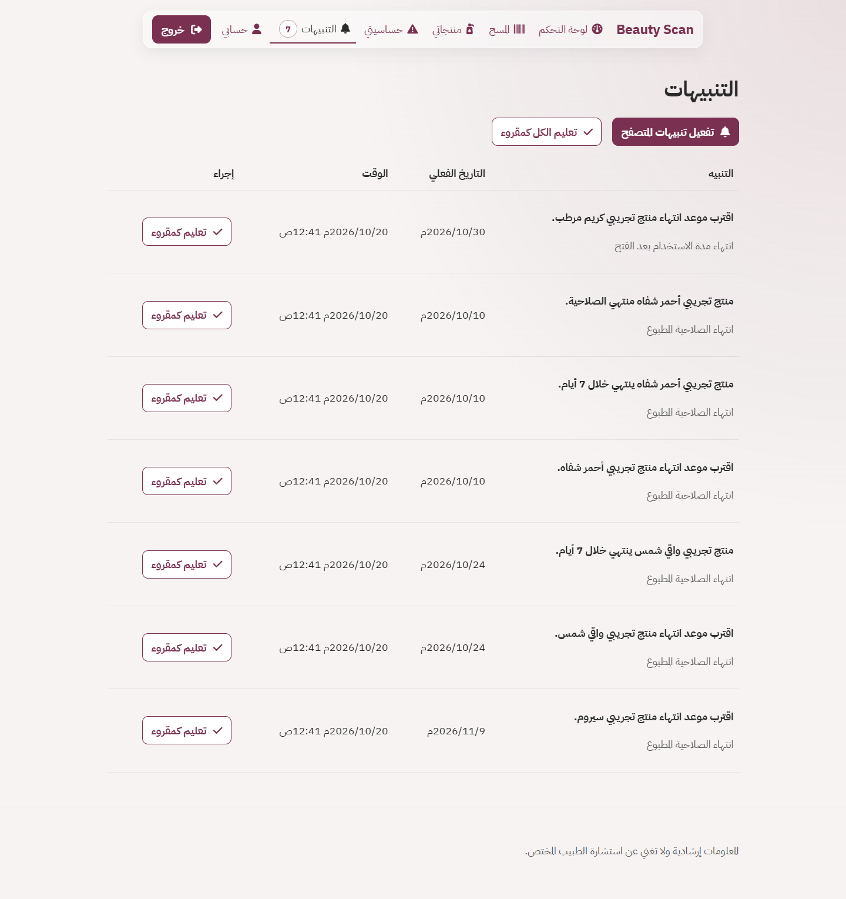
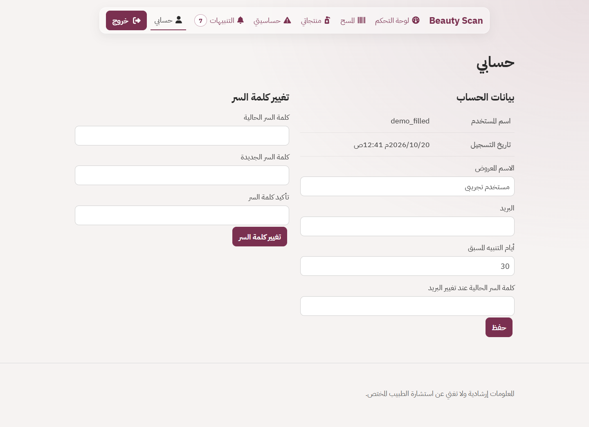

حساسيتي: المواد المسجلة ونموذج الإضافة. التنبيهات: النص والتاريخ الفعلي والوقت. حسابي: الاسم المعروض والبريد وأيام التنبيه، وبجانبه تغيير كلمة السر.

## 7. رحلة المستخدم

### زائر

الرئيسية `index.php` تعرض صوراً محلية (`hero-care.jpg` و`makeup-shelf.jpg` و`scan-hand.jpg` و`texture-cream.jpg`) وروابط الدخول والتسجيل. لا تُجلب بيانات حساب.

### بعد التسجيل أو الدخول

- إن `onboarding_done = 0`: التحويل إلى `onboarding.php`. يمكن الحفظ مع `finish` أو التخطي عبر `onboarding_skip`.
- إن `onboarding_done = 1`: التحويل إلى `dashboard.php`، أو إلى المسار في `next` إذا كان مساراً داخلياً قبله `safe_next()`.

عند الدخول الناجح تُستدعى `scan_user()` لذلك المستخدم.

### داخل النظام

الهيدر في `includes/header.php` يعرض للجاهز: لوحة التحكم، المسح، منتجاتي، حساسيتي، التنبيهات مع العدد، حسابي، والإدارة إن كان `is_admin = 1`، ثم خروج.

اختيار القسم يفتح صفحة PHP. النموذج يرسل إلى `api.php`. عند النجاح يظهر النص في عنصر الرسالة أو ينتقل المتصفح إلى المسار المعاد. القوائم تُعاد من قاعدة البيانات في الطلب التالي للصفحة.

`app.js` يطلب `unread` كل 60 ثانية ويحدّث `#unread-count`.

## 8. الوحدات والأقسام

لا توجد مجلدات Modules للتطبيق. كل قسم صفحة PHP ودوال في `includes/`.

| الصفحة | الوظيفة | أهم العمليات | العلاقة |
| --- | --- | --- | --- |
| `index.php` | رئيسية الزائر، والمستخدم الجاهز يراها أيضاً وفيها رابط للوحة التحكم | لا حفظ | إن لم يكتمل الإعداد يحوّل إلى `onboarding.php`. الشعار في الهيدر، لا هذه الصفحة، هو الذي يذهب إلى `dashboard.php` بعد اكتمال الإعداد |
| `login.php` / `register.php` | الدخول والتسجيل | `login` و`register` | تنشئ الجلسة |
| `onboarding.php` | أول تسجيل للحساسية | `allergens_save` و`onboarding_skip` | يفتح بقية الصفحات |
| `dashboard.php` | ملخص الحالات وجدول المنتجات | قراءة `list_user_products` و`status_counts` | يعرض نتيجة الصلاحية |
| `scan.php` | كاميرا أو رقم يدوي | `lookup` | يملأ `products` عند الجلب الخارجي ويفتح `product.php` |
| `product.php` | تفاصيل باركود | قراءة `ensure_product` | لا يضيف إلى الخزانة وحده |
| `products.php` | خزانة المستخدم | حذف عبر `product_delete` | صفوف `user_products` |
| `product_form.php` | إضافة أو تعديل `?id=` | `product_save` | يكتب الخزانة ثم يفحص التنبيه عند الدخول أو الفحص الدوري |
| `allergens.php` | مواد المستخدم | `allergens_save` و`allergens_delete` | تُستخدم في `match_allergens` |
| `notifications.php` | قائمة التنبيهات | `notification_read` و`notifications_read_all` | ناتج `scan_user` |
| `account.php` | الاسم والبريد وأيام التنبيه وكلمة السر | `account` و`password` | `notice_days` يغيّر عتبة «قريب الانتهاء» |
| `admin.php` | أعداد وتوثيق | `admin_verify` | يغيّر حكم المنتجات المحلية |

مجلد `modules/` فيه ملفات Python (`barcode_util.py` و`dates_util.py` و`expiry_util.py` و`text_util.py` و`envfile.py`). `bootstrap.php` لا يحمّلها. مسار التشغيل الحالي هو PHP. هذه الملفات موجودة على القرص وليست جزءاً من طلب المتصفح.

مجلد `screenshots/` فيه 32 صورة PNG موزعة على زائر ومستخدم فارغ ومستخدم ممتلئ وإدارة. ليست جزءاً من تشغيل الموقع. `.htaccess` لا يمنع هذا المجلد. اثنتا عشرة لقطة منها معروضة فوق داخل الشرح بعرض 420 أو 560. الباقي في المجلد نفسه.

## 9. الشركات والكيانات

غير موجود. لا جداول شركات ولا فروع ولا عزل بيانات بين مؤسسات. العزل الوحيد هو `user_id` في جداول المستخدم: الحساسية والمنتجات والتنبيهات.

## 10. الصلاحيات

المعنى العملي في هذا المشروع: الكود يفحص الجلسة ثم عمودين فقط.

- `require_login()`: لا جلسة، تحويل إلى `login.php` مع `next` إن كان المسار آمناً.
- `require_ready()`: جلسة مع `onboarding_done` غير 1، تحويل إلى `onboarding.php`.
- `require_admin()`: إن لم يكن `is_admin = 1` تُرجع الصفحة 403 ونص «هذه الصفحة للمسؤول فقط.»
- `api_user(true)` يشترط الجلسة واكتمال الإعداد. `admin_verify` يشترط `is_admin` داخل الإجراء نفسه.

لا توجد جداول أدوار ولا صلاحيات لكل زر. المستخدم يقرأ ويعدل صفوفه فقط لأن الاستعلامات تضيف `user_id` الخاص بالجلسة. المسؤول لا يملك في الكود شاشة لتعديل حساب شخص آخر أو حذف منتجاته.

## 11. الأتمتة وWorkflows

لا يوجد محرك سير عمل ولا موافقات ولا طابور.

ما يعمل تلقائياً:

- عند كل طلب ويب، `maybe_background_scan()` يقرأ `data/last_scan.txt`. إذا كان الملف فارغاً أو مرّت 6 ساعات، يستدعي `scan_all()` لكل المستخدمين ثم يكتب الوقت. القفل `flock` غير حاجب: إن كان فحص آخر ما زال ماسكاً الملف، هذا الطلب يتخطى الفحص.
- عند `login_user()` الناجح تُستدعى `scan_user()` لهذا المستخدم فقط.
- `scan_user()` يمر على `user_products`. المراحل من `stages_reached()`: `soon` إذا الأيام ضمن `notice_days`، و`week` إذا 7 أو أقل، و`expired` إذا التاريخ قبل اليوم. كل مرحلة صف تنبيه بمفتاح فريد.
- إن وُجد بريد للمستخدم ودالة `send_mail()` وجدت SMTP مكتملاً، تُرسل الرسالة. إن نقص SMTP تخرج الدالة دون إرسال. هذا السلوك من `includes/mailer.php`.

لا Cron ولا Worker ولا خدمة طابور في المشروع. إن لم يزر أحد الموقع لا يعمل الفحص العام.

## 12. التكامل بين الوحدات

- الحساسية في `user_allergens` لا تغيّر كتالوج `ingredients`. المطابقة وقت عرض المنتج فقط.
- جلب Open Beauty Facts يدرج صفاً في `products` بمصدر `open_beauty_facts` و`is_verified = 0`. التوثيق اليدوي من الإدارة يغيّر الحكم المحلي بعد اكتمال الحقول.
- خزانة `user_products` تشير إلى `products.id` ويمكن أن تبقى إذا حُذف منتج الكتالوج (`ON DELETE SET NULL`). حذف حساب المستخدم يحذف جلساته وحساسيته وخزانته وتنبيهاته (`ON DELETE CASCADE`).
- تغيير `notice_days` لا يعيد كتابة التنبيهات القديمة. التنبيه الجديد يُنشأ في الفحص التالي إذا لم يوجد المفتاح نفسه.
- صورة المنتج لا تُخزن في قاعدة البيانات. `product_photo()` يبحث عن ملف jpg باسم الباركود.

## 13. المصطلحات

| المصطلح | المعنى في هذا المشروع |
| --- | --- |
| باركود | رقم المنتج بعد `clean_barcode()`. الأطوال المقبولة 8 و12 و13: EAN-8 وUPC-A وEAN-13. UPC-E يُفك إلى UPC-A داخل `expand_upce()` ثم يُفحص |
| رقم المراقبة | الرقم الأخير. `check_digit()` يحسبه بأوزان 1 و3. EAN يبدأ الوزن من اليسار بـ 1، وUPC-A بـ 3 |
| INCI | الاسم الكيميائي الدولي في `ingredients.inci_name` |
| حكم موثوق `trusted` | رقم صحيح، واسم وعلامة ومكونات غير فارغة، و(`is_verified = 1` أو المصدر `open_beauty_facts`) |
| يحتاج إلى تحقق `needs` | أي نقص أو رقم خاطئ أو منتج غير موجود |
| PAO | `pao_months`: أشهر الاستخدام بعد الفتح |
| التاريخ الفعلي | الأبكر بين تاريخ الصلاحية وتاريخ الفتح زائد PAO. السبب `expiry` أو `pao` |
| قريب الانتهاء | الأيام المتبقية أكبر من 7 وضمن `notice_days` |
| CSRF | رمز في ترويسة `X-CSRF-Token` يطابق رمز الجلسة أو كعكة الزائر الموقعة |
| OBF | Open Beauty Facts، العنوان في `OBF_API_BASE` |

## 14. الأسئلة الشائعة

**هل أدخل بالبريد؟** لا. `login_user()` يبحث في `users.username` بعد تحويله إلى أحرف صغيرة.

**لماذا لا أرى القائمة بعد التسجيل؟** لأن `onboarding_done` ما زال 0 حتى الحفظ مع إنهاء أو التخطي.

**لماذا لا تُفحص الحساسية؟** `match_allergens()` إذا كان نص المكونات فارغاً يعيد حالة غياب البيانات، لا نتيجة سلبية.

**لماذا لم يُرسل بريد؟** `send_mail()` ترجع بلا إرسال إذا نقص `SMTP_HOST` أو `SMTP_PORT` أو `SMTP_USER` أو `SMTP_PASSWORD` أو `SMTP_FROM`، أو لم يكن للمستخدم بريد صالح. في البيئة المحلية المفحوصة `SMTP_HOST` فارغ.

**هل البحث الخارجي بلا حد؟** `allow_lookup()` يسمح بـ 30 عملية خلال 10 دقائق لكل مستخدم، والسجل في `data/lookup_rate.json`. البحث الخارجي لا يبدأ إلا إذا لم يوجد الباركود محلياً وكان رقم المراقبة صحيحاً.

**هل الكاميرا شرط؟** لا. `scan.php` يبقي النموذج اليدوي. الكاميرا تعمل على `localhost` أو HTTPS إذا سمح المتصفح.

**أين كلمات سر التجربة؟** غير موجودة في الواجهة ولا في هذا الملف. الملف المحلي `TEST_ACCOUNTS.txt` إن وُجد. إن غابت قيم `DEMO_*` في `.env` لا تُنشأ الحسابات.

## 15. Architecture

```text
المتصفح
  صفحات PHP (كل صفحة ملف)
  assets/js/app.js  -- fetch JSON -->  api.php?action=
                              |
                     includes/bootstrap.php
                       env, headers, session, init_db
                              |
        +---------+-----------+-----------+----------+
        |         |           |           |          |
      auth      products    cabinet   allergens   notify
        |         |           |           |          |
        +---------+-----------+-----------+----------+
                              |
                     PDO  MySQL / MariaDB
                     جداول users, sessions, products, ...

ملفات لا تمر من المتصفح: .env  includes/  data/  modules/
```

الاستنتاج من شكل الملفات: التطبيق متعدد الصفحات، والمنطق في دوال PHP بلا فئات ولا طبقة Controllers منفصلة. `api.php` هو الموجه الوحيد للإجراءات.

## 16. Tech Stack

موجود ويُستخدم:

- PHP 8. البيئة المحلية التي فُحصت: PHP 8.0.30، الامتدادات التي يعتمدها الكود: `pdo_mysql` و`mbstring` و`openssl`. `curl` يُستخدم إن فشل `file_get_contents` في `http_get()`.
- MySQL عبر PDO. الخادم المحلي المفحوص MariaDB 10.4 مع XAMPP، والاسم في `.env` هو `beauty_scan` على `127.0.0.1:3306`.
- HTML في ملفات PHP، CSS في `assets/css/style.css`، JavaScript في `assets/js/app.js` بلا إطار.
- خط IBM Plex Sans Arabic محلي. `@font-face` يربط الأوزان 400 و500 و700 فقط (Regular وMedium وBold).
- Font Awesome 6 Free محلي في `assets/vendor/fontawesome/` (العائلة في الملف: `Font Awesome 6 Free`). لا يُحمّل من الإنترنت بسبب سياسة المحتوى.
- Open Beauty Facts عبر HTTP GET. اختياري: SMTP بالدوال المدمجة `stream_socket_client`.

غير مستخدم رغم وجوده: ملفات Python في `modules/`. لا `composer.json` ولا `package.json`. المتغير `PORT` في `.env.example` لا تقرأه أي دالة `env('PORT')`.

## 17. Project Structure

```text
Beauty Scan/
  index.php login.php register.php onboarding.php
  dashboard.php scan.php product.php products.php product_form.php
  allergens.php notifications.php account.php admin.php
  api.php                 إجراءات JSON
  router.php              لخادم PHP المدمج فقط
  .htaccess               منع المسارات الحساسة على Apache
  .env.example            أسماء المتغيرات بلا قيم
  robots.txt
  includes/               دوال PHP، تُمنع من الويب
    bootstrap.php header.php footer.php allergen_form.php
    env.php security.php dates.php text.php barcode.php
    expiry.php match.php db.php auth.php mailer.php
    notify.php products.php cabinet.php allergens.php seed.php
    selfcheck.php         فحص دوال بلا قاعدة بيانات
  assets/
    css/style.css
    js/app.js
    fonts/                سبعة ملفات ttf، وثلاثة مربوطة في CSS
    images/               favicon.svg وصور الرئيسية
    images/products/      17 ملف jpg بأسماء الباركود
    vendor/fontawesome/
  data/                   app.log وlast_scan.txt وlookup_rate.json
  modules/                Python غير مستدعى من PHP
  screenshots/            لقطات توثيق، 32 ملفاً
```

## 18. Frontend

- **HTML:** كل صفحة تضم `includes/header.php` و`includes/footer.php`. الاتجاه `lang="ar" dir="rtl"`. الأيقونة `assets/images/favicon.svg`. إن وُجد `assets/images/logo.png` يُعرض في الهيدر، وإلا النص Beauty Scan. الملف غير موجود حالياً، فيظهر النص.
- **CSS:** ملف واحد `assets/css/style.css`. الهيدر `backdrop-filter` مع `-webkit-backdrop-filter`. من عرض 800px تتحول `.layout` و`.field-grid` إلى عمودين، و`.stats` إلى أربعة أعمدة. جداول `.data-table` بخط سفلي خفيف. صفحات الدخول والتسجيل تقسم الشاشة: النموذج والصورة.
- **JavaScript:** ملف واحد. يقرأ `csrf-token`، ويرسل `fetch` إلى `/api.php?action=`. الكاميرا في صفحة `data-page=scan`. لا موجّه من جهة العميل.
- **القوالب:** لا محرك قوالب. PHP يطبع HTML، والهروب عبر `h()`.
- **التوجيه:** مسار الملف نفسه، مثل `/products.php`. `router.php` يخدم الملفات على `php -S` فقط. على Apache الملفات تُنفذ مباشرة و`.htaccess` يمنع المسارات الحساسة.
- **تحميل البيانات:** الصفحات تقرأ من MySQL أثناء التوليد. الواجهة لا تعيد رسم الجداول من JSON إلا عداد التنبيهات ونص آخر تنبيه غير مقروء.
- **التجاوب:** قاعدة التصميم للجوال، وعمودان من 800px. تحت 800px صفحة الدخول تصبح ارتفاعاً تلقائياً والصورة في الأعلى.

`formatDate` و`formatDateTime` في `app.js` تُستخدمان لنص التنبيه القادم من `unread` فقط. تواريخ الصفحات يطبعها PHP عبر `show_date()` و`show_datetime()` كنص واحد، مثل `2026/1/3م` و`2026/1/3م 5:50ص`. التخزين UTC، والعرض يضيف 3 ساعات.

## 19. Backend

- **PHP:** صفحات وإجراءات. لا فئات. لا مساحة أسماء.
- **API:** ملف `api.php` يقرأ `action` و`REQUEST_METHOD`.
- **التوجيه:** سلسلة `if` في `api.php`. الإجراء غير المعروف يرجع 404 و`الطلب غير معروف`.
- **المنطق:** دوال في الملفات المذكورة في الشجرة. أمثلة: `judge_product` و`match_allergens` و`effective_expiry` و`save_user_product` و`scan_user`.
- **الوصول للبيانات:** `db()` تعيد PDO بـ `ERRMODE_EXCEPTION` و`EMULATE_PREPARES = false`. `db_all` و`db_one` و`db_exec` و`db_insert` تمرّر المعاملات للمُجهّز. استثناء: `init_db()` و`ensure_admin_column()` ينفّذان SQL ثابتاً بلا مدخلات مستخدم.

## 20. Request Flow

مثال: إضافة مادة حساسية من `allergens.php`.

```text
المتصفح
  app.js يجمع الأسماء ويرسل POST /api.php?action=allergens_save
  الجسم JSON: { "names": ["Parfum"] }
  الترويسة X-CSRF-Token من وسم meta
        |
api.php
  bootstrap: جلسة، CSRF، قاعدة البيانات
  POST بلا رمز صحيح: 403 «تعذر تنفيذ الطلب»
  api_user(false): بلا جلسة 401
  add_allergens(user id, names)
        |
MySQL
  INSERT في user_allergens أو تجاهل المكرر
        |
JSON { "ok": true, "message": "..." }
        |
المتصفح يعرض الرسالة أو يعيد تحميل القائمة من الصفحة
```

مثال قراءة: `GET /dashboard.php` لا يمر على `api.php`. PHP يستدعي `list_user_products()` ويطبع الجدول.

## 21. Database

- النوع: MySQL، المحرك في `CREATE TABLE` هو InnoDB والترميز `utf8mb4`.
- الاسم في الإعداد المحلي المفحوص: `beauty_scan`. الكود إن غاب `DB_NAME` يستخدم الاسم نفسه كقيمة افتراضية داخل `db()`.
- الاتصال: `mysql:host=...;port=...;dbname=...;charset=utf8mb4`. القيم من `.env`.
- الاستعلامات: مُجهّزة عبر PDO كما في القسم 19.
- لا مجلد migrations. الإنشاء في `init_db()` عند أول طلب ويب. لا سكربت seed منفصل. التعبئة داخل `seed_if_needed()` إذا كان عدد `ingredients` أو `products` صفراً.
- فحص محلي بتاريخ 2026/10/20م: users=3 (مسؤول واحد، والآخران `onboarding_done = 1`)، sessions=13، login_attempts=1، products=17 وكلها `source=local_verified` (14 موثّقاً و3 غير موثّقة)، ingredients=85، user_allergens=2، user_products=5، notifications=7.

| الجدول | المفتاح | العلاقات |
| --- | --- | --- |
| `users` | `id`، و`username` فريد | الأصل للحساب |
| `sessions` | `id` نص SHA-256 | `user_id` يحذف مع المستخدم |
| `login_attempts` | `id`، فهرس `(username, ip, attempted_at)` | بلا مفتاح أجنبي |
| `products` | `id`، و`barcode` فريد | كتالوج مشترك |
| `ingredients` | `id`، و`inci_name` فريد | كتالوج مشترك |
| `user_allergens` | `id`، فريد `(user_id, normalized_name)` | مستخدم CASCADE، مكوّن SET NULL |
| `user_products` | `id`، فهرس `user_id` | مستخدم CASCADE، منتج SET NULL |
| `notifications` | `id`، و`dedupe_key` فريد | مستخدم CASCADE، منتج المستخدم CASCADE |

تناقض حالة البيانات مع نية التعبئة: `seed_one_demo()` للحساب الفارغ يمرّر `onboarding_done = 0`، لكنه يعود فوراً إذا كان اسم المستخدم موجوداً ولا يعدّل الصف. في القاعدة المفحوصة الحسابان غير الإداريين كلاهما `onboarding_done = 1`. هذا وصف للبيانات الحالية وليس لشرط الكود عند أول إنشاء.

`ensure_admin_column()` يضيف `is_admin` للجداول القديمة التي أُنشئت قبل هذا العمود.

## 22. API

كل المسارات تحت `/api.php?action=`. الجسم JSON بحد 65536 بايت في `json_body()`. الاستجابة `{"ok": true|false, ...}` وترويسة `Content-Type: application/json`.

طلبات POST ترفض بـ 403 إذا فشل `csrf_ok()` قبل تنفيذ الإجراء. GET لا يمر على هذا الفحص.

| action | Method | من يدخل | المعاملات | النتيجة |
| --- | --- | --- | --- | --- |
| `register` | POST | زائر (بلا فحص جلسة) | `username` `display_name` `password` `confirm` `email` | نجاح: `redirect` إلى `/onboarding.php` |
| `login` | POST | زائر | `username` `password` `next` | `redirect` إلى لوحة التحكم أو الإعداد أو `next` الآمن |
| `logout` | POST | جلسة | لا | `redirect` إلى `/` |
| `ingredients` | GET | جلسة | لا | `items`: id وinci وarabic وsynonyms |
| `allergens_save` | POST | جلسة | `names` مصفوفة، حد 40. `finish` اختياري | رسالة أو تحويل إلى لوحة التحكم |
| `allergens_delete` | POST | جلسة | `id` | `ok` أو 400 |
| `onboarding_skip` | POST | جلسة | لا | تحويل إلى لوحة التحكم |
| `lookup` | POST | جلسة جاهزة | `barcode` | تحويل إلى `product.php?barcode=` |
| `product_save` | POST | جلسة جاهزة | حقول النموذج و`id` للتعديل | `redirect` من `save_user_product` |
| `product_delete` | POST | جلسة جاهزة | `id` | `ok` أو 400 |
| `unread` | GET | جلسة جاهزة | لا | حمولة `unread_payload` |
| `notification_read` | POST | جلسة جاهزة | `id` | `unread` العدد |
| `notifications_read_all` | POST | جلسة جاهزة | لا | `unread: 0` |
| `account` | POST | جلسة جاهزة | `display_name` `email` `notice_days` `current_password` | رسالة |
| `password` | POST | جلسة جاهزة | `current_password` `password` `confirm` | رسالة |
| `admin_verify` | POST | مسؤول جاهز | `id` `is_verified` 1 أو 0 | `ok` أو 403 أو 400 |

لا توجد واجهة REST بأسماء مسارات أخرى. لا مصادقة بمفتاح API. الجلسة هي المصادقة.

## 23. Authentication & Authorization

- التسجيل والدخول في `includes/auth.php`.
- كلمة السر لا تُحفظ. `password_hash` بخوارزمية bcrypt. عند اسم غير موجود يُستدعى `dummy_hash()` حتى يمر التحقق بزمن مشابه.
- رسالة الفشل واحدة: «بيانات الدخول غير صحيحة»، إلا عند القفل: «تعذر تسجيل الدخول حالياً. حاول لاحقاً».
- القفل: `login_locked()` إذا وُجدت 5 محاولات خلال 15 دقيقة لنفس الاسم ونفس IP. المحاولات الأقدم من يوم تُحذف في بداية `login_user()`.
- الكعكة `bs_session`: HttpOnly، SameSite=Lax، والعمر الأقصى 8 ساعات. `Secure` فقط إذا كان الطلب HTTPS (`request_is_secure()`). الخمول 30 دقيقة يحذف صف الجلسة.
- الخروج يحذف صف `sessions` ويمسح الكعكة.
- للزائر كعكة `bs_csrf` قيمتها `token.hmac` بتوقيع `sign_token()` ومفتاح `SECRET_KEY`، عمرها 8 ساعات، وليست HttpOnly لأن الصفحة تحتاج قراءة الرمز. رمز الجلسة بعد الدخول يأتي من `sessions.csrf_token` ويُطبع في `<meta name="csrf-token">`.
- اسم المستخدم يُطبَّع بـ `normalize_username()` (trim ثم أحرف صغيرة).

لا يوجد «تذكرني» منفصل عن عمر الكعكة. لا يوجد استعادة كلمة سر. لا يوجد تحقق بريد عند التسجيل. لا يوجد دخول ببصمة.

## 24. Security

موجود في الكود:

- CSRF على كل POST إلى `api.php`.
- PDO بمُجهّزات. `h()` للهروب في HTML عبر `htmlspecialchars`.
- bcrypt لكلمات السر.
- جلسات كما في القسم 23.
- تفويض `require_ready` و`require_admin` و`api_user`.
- حد محاولات الدخول، وحد 30 جلب خارجي لكل مستخدم كل 10 دقائق.
- جسم JSON بحد 64 كيلوبايت. استجابة المصدر الخارجي تُرفض إن تجاوزت 1000000 بايت.
- `safe_next()` يرفض المسارات التي لا تبدأ بـ `/` واحد أو فيها `//` أو `\` أو `://` أو أسطر جديدة.
- رؤوس من `send_security_headers()`: `Content-Security-Policy` للنفس فقط، `X-Frame-Options: DENY`، `X-Content-Type-Options: nosniff`، `Referrer-Policy: same-origin`، `Permissions-Policy` تسمح بالكاميرا لنفس المصدر وتغلق الميكروفون والموقع، و`Strict-Transport-Security` عند HTTPS. يُحذف `X-Powered-By` من PHP.
- `.htaccess` يطفئ فهرسة المجلدات و`ServerSignature`، ويمنع الملفات النقطية و`includes` و`data` و`modules` و`README.md` و`router.php` و`TEST_ACCOUNTS.txt` وامتدادات sqlite وsql وlog وbak وini.
- `router.php` على خادم PHP المدمج يمنع المسارات نفسها ويرجع 404. إذا استُدعي `router.php` وهو ليس `cli-server` يرجع 404 ونص «غير موجود» ولا يوجّه الموقع.
- `display_errors=0`. الاستثناء يُسجل في السجل كنص عام `request failed`، والمستخدم يرى «تعذر الاتصال بقاعدة البيانات» أو «حدث خطأ غير متوقع».
- `robots.txt` يحتوي `User-agent: *` و`Allow: /` فقط، بلا مسارات إدارة.
- رفع ملفات من المستخدم: غير موجود، لذلك لا فحص نوع ملف مرفوع.

غير موجود: حد عام لكل المسارات غير الدخول والبحث الخارجي، سجل تدقيق لعمليات المسؤول، تشفير أعمدة غير كلمة السر، جدار تطبيقات، خدمة مراقبة.

## 25. Configuration

الملف `.env` بجانب `index.php`. `.env.example` يوثق الأسماء بلا قيم. `.gitignore` يستثني `.env` و`TEST_ACCOUNTS.txt` و`data/*`.

| المتغير | الاستخدام |
| --- | --- |
| `SECRET_KEY` | توقيع كعكة CSRF للزائر. إن كان فارغاً فالتوقيع فارغ |
| `PORT` | موجود في المثال وغير مقروء في الكود |
| `DB_HOST` `DB_PORT` `DB_NAME` `DB_USER` `DB_PASSWORD` | اتصال PDO. الغياب يستخدم 127.0.0.1 و3306 و`beauty_scan` |
| `OBF_API_BASE` | أساس طلب `/product/{barcode}.json`. إن كان فارغاً لا يُجلب خارجياً |
| `SMTP_HOST` `SMTP_PORT` `SMTP_USER` `SMTP_PASSWORD` `SMTP_FROM` | البريد. النقص يوقف الإرسال |
| `DEMO_EMPTY_USERNAME` `DEMO_EMPTY_PASSWORD` | حساب يُنشأ مرة واحدة باسم «مستخدم جديد» و`onboarding_done=0` |
| `DEMO_FILLED_USERNAME` `DEMO_FILLED_PASSWORD` | حساب «مستخدم تجريبي» مع حساسية ومنتجات |
| `DEMO_ADMIN_USERNAME` `DEMO_ADMIN_PASSWORD` | حساب «مسؤول». إن كان الاسم موجوداً يُحدَّث `is_admin=1` و`onboarding_done=1` دون تغيير كلمة السر |

لا تُكتب القيم الحقيقية في هذا الملف ولا في Git. الاتصال المحلي المفحوص يستخدم المستخدم `root`. لا يوجد في المشروع سكربت ينشئ مستخدم قاعدة بصلاحيات محدودة.

## 26. Integrations

- **Open Beauty Facts:** `fetch_obf()` يطلب `{OBF_API_BASE}/product/{barcode}.json` بمهلة 6 ثوانٍ، ويتحقق من شهادة TLS، ويرسل User-Agent `BeautyScan STEM (educational; local use)`. الحقول المقروءة: `product_name_ar` أو `product_name`، و`brands`، و`categories`، و`ingredients_text_ar` أو `ingredients_text` أو `ingredients_text_en`. الحالة 1 فقط تُعد نجاحاً.
- **البريد:** SMTP مباشر في `includes/mailer.php` بلا مكتبة. البيئة المحلية: المضيف فارغ، فالإرسال غير مفعّل.
- غير موجود في الكود والإعداد: SMS، تحليلات، Cloudflare، تخزين كائنات، مراقبة خارجية، دفع، خرائط.

## 27. Scheduled Jobs

غير موجود كخدمة. البديل الوحيد هو `maybe_background_scan()` الموضح في القسم 11، مرتبط بطلب زائر، والفاصل 6 ساعات، والعلامة `data/last_scan.txt`.

## 28. File Storage

- لا مجلد رفع للمستخدم ولا إجراء رفع في `api.php`.
- صور المنتجات ملفات ثابتة `assets/images/products/{أرقام الباركود}.jpg`. الفحص وجد 17 ملفاً.
- صور الواجهة: `hero-care.jpg` و`makeup-shelf.jpg` و`scan-hand.jpg` و`texture-cream.jpg` و`favicon.svg`.
- `data/` ملفات تشغيل: السجل، وقت الفحص، عداد البحث. الصلاحية عند الإنشاء `0700`. المجلد ممنوع من الويب.
- الخطوط في `assets/fonts/`: Thin وExtraLight وLight وRegular وMedium وSemiBold وBold، وملف `OFL.txt`. CSS يربط Regular (400) وMedium (500) وBold (700) فقط.

## 29. Logging & Monitoring

- `error_log` إلى `data/app.log`. معالج الاستثناء يسجل الجملة `request failed` بلا تفاصيل الطلب للمستخدم.
- أخطاء PDO تظهر للمستخدم كرسالة اتصال عامة إذا كان الاستثناء `PDOException`.
- لا مستويات سجل، ولا تدوير، ولا تنبيهات، ولا لوحة مراقبة، ولا معرف طلب.

تدقيق الأعمال: غير موجود. تغيير `is_verified` لا يُكتب في جدول تاريخ.

## 30. Installation

المتطلبات التي يعتمدها الكود: PHP 8، و`pdo_mysql`، و`mbstring`، و`openssl`، وخادم MySQL أو MariaDB. الكاميرا في المتصفح اختيارية.

1. انسخ `.env.example` إلى `.env`.
2. ضع `SECRET_KEY` بقيمة عشوائية طويلة.
3. ضع `DB_HOST` و`DB_PORT` و`DB_NAME` و`DB_USER` و`DB_PASSWORD`. أنشئ القاعدة الفارغة بهذا الاسم. الجداول تُبنى من `init_db()` وليست من ملف SQL منفصل.
4. ضع `OBF_API_BASE` إن أردت البحث الخارجي. القيمة المستخدمة في التوثيق السابق للمشروع: `https://world.openbeautyfacts.org/api/v2`.
5. اترك SMTP فارغاً لتعطيل البريد، أو املأه لإرسال تنبيه الصلاحية.
6. حسابات التجربة اختيارية عبر `DEMO_*`. لا تضع كلمات السر في Git.
7. من مجلد المشروع:

```text
php -S localhost:8000 router.php
```

8. افتح `http://localhost:8000`.

أول طلب ويب ناجح ينشئ الجداول والتعبئة. فحص الدوال بلا قاعدة:

```text
php includes/selfcheck.php
```

على الجهاز المحلي، MySQL الخاص بـ XAMPP يجب أن يكون شغالاً قبل الموقع. أمر التشغيل يثبّت المنفذ 8000 في سطر الأوامر ولا يقرأ `PORT`.

## 31. Development Guide

النمط الحالي، بلا مولدات:

- **صفحة:** ملف `name.php` في الجذر يستدعي `bootstrap.php`، ويضبط `$pageTitle` و`$pageId`، ويضم `header.php` ثم المحتوى ثم `footer.php`. إن كانت للداخل استخدم `require_ready()` أو `require_admin()`. أضف الرابط في `includes/header.php` إن كان قسماً ظاهراً.
- **منطق:** دالة في ملف `includes/` المناسب، ثم `require` لها من `bootstrap.php` إن كان ملفاً جديداً.
- **إجراء API:** فرع جديد في `api.php` باسم `action` وطريقة HTTP، واستدعِ `api_user` إن لزم، وأعد `json_out`. أضف الطلب في `assets/js/app.js` مع ترويسة CSRF.
- **جدول أو عمود:** أضف `CREATE TABLE IF NOT EXISTS` داخل `init_db()` للجداول الجديدة. الأعمدة على جدول موجود لا تُضاف تلقائياً إلا بنمط `ensure_admin_column()` الذي يفحص `SHOW COLUMNS`. لا يوجد نظام ترحيل يطبّق تغييراً على قاعدة فيها بيانات.
- **صلاحية:** اليوم إما جاهز أو مسؤول. صلاحية جديدة تعني شرطاً صريحاً في الصفحة وفي `api.php`، لأنه لا جدول صلاحيات.
- **تاريخ معروض:** استخدم `show_date()` أو `show_datetime()` في PHP. لا تغلف الناتج بوسوم.

بعد تعديل دوال الباركود أو التاريخ أو المطابقة، شغّل `php includes/selfcheck.php`.

## 32. Deployment

ما هو مكتوب للإنتاج داخل المشروع:

- `.htaccess` لمنع الملفات الحساسة وإخفاء التوقيع على Apache الذي يدعم `mod_headers` و`mod_rewrite`.
- رؤوس الأمان من PHP، بما فيها HSTS عند HTTPS.
- `display_errors` مغلق.
- `router.php` ليس موجّه Apache. طلبه خارج `cli-server` يرجع 404. الموقع على Apache يخدم `index.php` وبقية ملفات PHP مباشرة، و`.htaccess` هو المنع.

غير موجود في المستودع: ملف نشر، وDocker، وCI، وإعداد Nginx، وسكربت نسخ. `PORT` لا يؤثر على Apache.

عند النشر تُوضع أسرار `.env` على الخادم خارج Git. مستخدم القاعدة في الإنتاج يجب أن يكون غير مستخدم الإدارة إن وفرت الاستضافة ذلك. حسابات `DEMO_*` إن وُضعت على خادم عام تُنشئ دخولاً يعمل، وهذا قرار نشر وليس سلوكاً افتراضياً موثقاً كمتطلب إنتاج.

## 33. Backup & Recovery

غير موجود. لا سكربت نسخ، ولا أمر استعادة، ولا جدولة. النسخ يتم خارج المشروع بأدوات MySQL إن وُجدت على الخادم. مجلد `data/` ليس نسخة من القاعدة.

حذف القاعدة يمسح الحسابات. إعادة أول طلب تعيد إنشاء الجداول وتعبئة المكونات والمنتجات فقط إذا كانت الجداول فارغة، وحسابات التجربة فقط إذا غابت أسماؤها.

## 34. Troubleshooting

| العرض | ما يفحصه الكود أو الإعداد |
| --- | --- |
| «تعذر الاتصال بقاعدة البيانات» | MySQL متوقف، أو قيم `DB_*` خاطئة، أو القاعدة غير منشأة. الرسالة عامة عمداً. التفاصيل في `data/app.log` إن كُتب الاستثناء قبل الرسالة العامة |
| صفحة 404 ونص «غير موجود» من `router.php` | الملف استُدعي على Apache. لا تجعله موجّه الاستضافة |
| «تعذر تنفيذ الطلب» على الحفظ | رمز CSRF غير مطابق أو الكعكة محذوفة |
| «يلزم تسجيل الدخول» | لا كعكة `bs_session` صالحة |
| «أكمل إعداد الحساسية أولاً» | `onboarding_done` ليس 1 وإجراء `api_user(true)` |
| «تعذر تسجيل الدخول حالياً» | 5 محاولات فاشلة خلال 15 دقيقة لنفس الاسم وIP |
| بحث خارجي لا يضيف منتجاً | المنتج موجود محلياً، أو رقم المراقبة خاطئ، أو `OBF_API_BASE` فارغ، أو الشبكة، أو الحد 30 خلال 10 دقائق |
| لا بريد | SMTP ناقص أو المستخدم بلا بريد |
| الكاميرا لا تعمل | المتصفح بلا `BarcodeDetector`، أو الصفحة ليست localhost ولا HTTPS، أو الإذن مرفوض. الحقل اليدوي يبقى |
| خط أو أيقونة لا تظهر | سياسة المحتوى تمنع أي نطاق غير الموقع. الملفات يجب أن تُخدم من `assets/` |

## 35. Dependencies

لا مدير حزم PHP ولا JavaScript.

- PHP 8.0.30 في بيئة الفحص، مع PDO MySQL وmbstring وopenssl وcurl إن لزم الجلب.
- MariaDB 10.4 عبر XAMPP في بيئة الفحص. الكود لا يثبّت إصداراً أدنى داخل SQL.
- Font Awesome 6 Free ملفات محلية. رقم الإصدار الأدق غير مكتوب داخل `icons.css` الذي فُحص، والعائلة `Font Awesome 6 Free`.
- خط IBM Plex Sans Arabic ملفات محلية، الترخيص في `assets/fonts/OFL.txt`.
- Open Beauty Facts خدمة خارجية اختيارية، بلا مكتبة عميل.

ملفات `modules/*.py` لا تُستورد من PHP. إصدار Python المطلوب لها غير موثق في المشروع ولا يوجد `requirements.txt`.

## 36. Known Limitations

من الكود نفسه:

- الفحص العام لا يعمل إلا إذا وصل طلب ويب بعد 6 ساعات. لا جدولة مستقلة.
- `seed_one_demo()` لا يحدّث حساباً موجوداً. تغيير `.env` لاحقاً لا يبدل كلمة السر ولا يعيد `onboarding_done` للحساب الفارغ. `seed_admin()` يحدّث العلمين إذا وُجد الاسم، ولا يحدّث كلمة السر.
- لا ترحيل للأعمدة إلا فحص `is_admin`.
- لا استعادة لكلمة السر ولا تأكيد بريد.
- تغيير البريد يطلب كلمة السر الحالية ولا يرسل رمز تحقق.
- لا رفع صور. منتج بلا ملف jpg يظهر بلا صورة.
- `PORT` في المثال غير موصول.
- أربعة أوزان خط موجودة كملفات وغير مربوطة في `@font-face`.
- `router.php` على غير خادم PHP المدمج لا يشغّل الموقع.
- المستخدم المحلي للقاعدة هو `root`. هذا وصف للبيئة المفحوصة، وليس إعداد الإنتاج المقصود في قسم النشر.
- مجلد `screenshots/` قابل للطلب على Apache لأن `.htaccess` لا يمنعه.
- مجلد `modules/` غير مستخدم من مسار PHP.

## 37. Current System State

يعمل من الملفات: الصفحات المذكورة، و`api.php`، وإنشاء الجداول، والتعبئة الأولى، والدخول، والحساسية، والمسح، والخزانة، والتنبيهات داخل الموقع، والإدارة، وفحص `selfcheck.php`.

الحكم والمطابقة والصلاحية مكتملة كدوال ولها فحص في `includes/selfcheck.php`.

غير مكتمل بالنسبة لما قد يُتوقع وليس مكتوباً: البريد ما لم تُملأ SMTP (محلياً فارغة)، والبحث الخارجي ما لم يُضبط `OBF_API_BASE` (محلياً المتغير موجود وغير فارغ)، واستعادة كلمة السر غير مبنية، والنسخ الاحتياطي غير مبني، وجدولة الفحص غير مبنية.

غير موثق خارج الكود: سبب بقاء ملفات Python، ومتى أُنجزت اللقطات كمتطلب، واسم منتج النشر، وأي بيئة إنتاج سابقة. لا وثيقة قرار معمارية منفصلة.

حالة القاعدة المحلية ليست تعريفاً للمنتج: الأعداد في القسم 21 تتغير بالاستخدام. نية التعبئة للحساب الفارغ `onboarding_done = 0` تختلف عن الصف الحالي.

## 38. Architecture Decisions

ما يمكن إثباته من الكود، والسبب الظاهر من الشكل نفسه:

- صفحات PHP متعددة بدل إطار: كل شاشة ملف، والمشترك `header.php` و`bootstrap.php`. لا اعتماد Composer.
- إجراء واحد `api.php` بدل ملفات مسارات: كل الفروع في ملف واحد.
- PDO مُجهّز وbcrypt: ظاهر في `db.php` و`auth.php`.
- الجلسة رمز عشوائي ومخزنه هاش: `token_hash()` ثم `sessions.id`.
- كتالوج مشترك وصفوف خاصة بالمستخدم: `products` بلا `user_id`، والخزانة والحساسية بها `user_id`.
- التعبئة عند أول اتصال إذا كان الجدول فارغاً: لا ملف SQL خارجي.
- الفحص الدوري داخل الطلب: التعليق في `maybe_background_scan()` يقول إن PHP لا يبقي خيطاً بين الطلبات.
- السياسة تمنع المصادر الخارجية في الصفحة: الخط والأيقونات محلية حتى تعمل مع `default-src 'self'`.
- التاريخ نص من PHP: `show_date` و`show_datetime` تعيدان سلسلة، و`selfcheck.php` يثبت `2026/1/3م` و`2026/1/3م 5:50ص`.

سبب اختيار PHP أو MySQL غير مكتوب في تعليق قرار. وصف التقنية موجود في هذا الملف لأنه واقع الكود.

## 39. Changelog

غير موجود. لا Git tags ولا ملف إصدارات داخل المشروع وقت كتابة هذه الوثيقة. لا يُخترع سجل هنا.

## System Overview

```text
زائر ---- دخول / تسجيل ----> جلسة bs_session
                |
                v
        إعداد الحساسية (مرة)
                |
                v
        +-------+--------+------------------+
        |                |                  |
     المسح            خزانتي            حساسيتي
   باركود محلي      user_products     user_allergens
   أو OBF إن غاب         |                  |
        |                v                  |
        +--------> product.php <------------+
                  حكم + مطابقة
                         |
                         v
                  scan_user / scan_all
                         |
                         v
                  notifications (+ SMTP إن اكتمل)
                         |
                         v
                  account.php (الاسم، البريد، أيام التنبيه، كلمة السر)

is_admin = 1 ----> admin.php يغيّر products.is_verified
```

## Quick Reference

| الجزء | التقنية | الموقع | الوظيفة |
| --- | --- | --- | --- |
| الصفحات | PHP HTML | جذر المشروع `*.php` | الشاشات |
| الواجهة | CSS JS | `assets/css` `assets/js` | الشكل والطلبات |
| الإجراءات | PHP JSON | `api.php` | الحفظ والبحث |
| التشغيل المشترك | PHP | `includes/bootstrap.php` | بيئة، جلسة، جداول |
| الحساب | PHP | `includes/auth.php` | دخول وجلسة |
| المنتجات | PHP | `includes/products.php` | حكم وجلب وصورة |
| الخزانة | PHP | `includes/cabinet.php` | حفظ تواريخ المستخدم |
| الحساسية | PHP | `includes/allergens.php` `includes/match.php` | تسجيل ومطابقة |
| الصلاحية | PHP | `includes/expiry.php` `includes/notify.php` | تاريخ فعلي وتنبيه |
| الباركود | PHP | `includes/barcode.php` | صيغ وأرقام مراقبة |
| التواريخ | PHP | `includes/dates.php` | عرض بتوقيت المملكة |
| القاعدة | PDO MySQL | `includes/db.php` | جداول واستعلامات |
| البريد | PHP sockets | `includes/mailer.php` | SMTP اختياري |
| التعبئة | PHP | `includes/seed.php` | 85 مكوّناً و17 منتجاً |
| الحماية | PHP Apache | `includes/security.php` `.htaccess` | رؤوس ومنع ملفات |
| خادم محلي | PHP المدمج | `router.php` | `php -S` فقط |
| الإعداد | env | `.env` | أسرار واتصال |
| مصدر خارجي | HTTP | `OBF_API_BASE` | Open Beauty Facts |
| لقطات | PNG | `screenshots/` | توثيق بصري لا تشغيل |

## Quick Start

```text
php -S localhost:8000 router.php
```

من مجلد المشروع بعد وجود `.env` وMySQL وقاعدة فارغة باسم `DB_NAME`. ثم `http://localhost:8000`. التفاصيل في [التركيب](#30-installation).

## For Non-Technical Users

Beauty Scan موقع تراجع فيه منتج مكياج أو عناية برقمه. تسجّل حساباً، تكتب المواد التي تتحسس منها أو تتخطى هذه الخطوة، ثم تمسح الرقم أو تكتبه. الموقع يقول إن كانت بيانات المنتج مكتملة وموثقة، ويعرض المواد المطابقة لحساسيتك إن وُجدت قائمة مكونات. من «منتجاتي» تضيف ما عندك مع تاريخ الصلاحية وتاريخ الفتح، فيظهر إن كان صالحاً أو قريباً أو منتهياً، ويصلك تنبيه داخل الموقع. إن كُتب بريدك وضُبط البريد على الخادم يصلك تنبيه بالبريد أيضاً. المسؤول فقط يرى صفحة الإدارة ويعلّم المنتج موثّقاً أو يلغي ذلك.

الأقسام بعد إكمال الإعداد: لوحة التحكم، المسح، منتجاتي، حساسيتي، التنبيهات، حسابي، والإدارة للمسؤول.

## For Developers

- **Stack:** PHP 8 بلا إطار، MySQL عبر PDO، HTML، ملف CSS واحد، ملف JS واحد، جلسة بكعكة، JSON في `api.php`.
- **Architecture:** MPA. `bootstrap.php` ثم دوال `includes/` بلا فئات. Apache يخدم الملفات و`.htaccess` يمنع الحساس. `router.php` لـ `php -S` فقط.
- **Database:** InnoDB، `init_db()` ينشئ الجداول، التعبئة إذا كان الكتالوج فارغاً. الاسم المحلي `beauty_scan`.
- **API:** `GET|POST /api.php?action=` والجدول في القسم 22. POST يحتاج `X-CSRF-Token`.
- **ملفات البداية:** `includes/bootstrap.php`، `api.php`، `includes/db.php`، `includes/auth.php`، `includes/products.php`، `assets/js/app.js`.
- **تطوير:** صفحة جديدة ملف PHP في الجذر، إجراء جديد فرع في `api.php`، عمود جديد لا يرحَّل وحده. الفحص: `php includes/selfcheck.php`.
- **لا تُرفع:** `.env` و`TEST_ACCOUNTS.txt` ومحتوى `data/`.
